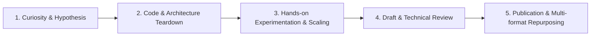

# Content Lab 🧪

Welcome to **Content Lab** — an engineering-driven workshop for turning raw technical curiosity, hands-on experiments, and deep architectural explorations into high-impact articles, tutorials, and eventually video essays.

Rather than rehashing documentation or high-level summaries, Content Lab operates on a simple principle: **build it, break it, measure it, and share what actually happened**.

---

## 🎯 Vision & Philosophy

Modern AI and software engineering move too fast for surface-level commentary. The goal of Content Lab is to bridge the gap between academic papers/corporate press releases and practical developer reality.

1. **First-Principles Exploration**: Dive under the hood into architecture, tokenizer mechanics, loss functions, latency profiling, and trade-offs.
2. **Reproduction & Extension**: Don't just read the code — run it, scrutinize the team's failed iterations, and test hypotheses (e.g., *"Does scaling this from 2B to 4B actually improve decision accuracy or just inflate latency?"*).
3. **Radical Transparency**: Highlight what worked, what failed, where the original team struggled, and where conventional wisdom falls short.
4. **Progressive Media Roadmap**:
   - **Phase 1: Deep Technical Articles & Teardowns** (In-depth breakdowns, benchmarks, code walkthroughs).
   - **Phase 2: Reproducible Tutorials & Notebooks** (Clean recipes for practitioners to replicate results).
   - **Phase 3: Video Essays & Visual Walkthroughs** (High-production technical explainers and demonstrations).

---

## 📂 Repository Structure

```text
content-lab/
├── README.md                          # Vision, pipeline, and track directory
├── articles/                          # Deep technical articles and teardowns
│   └── 01-strands-decider-2b/         # Exploration 01: Strands Decider 2B & 4B Scaling
│       ├── OUTLINE.md                 # Article outline and narrative structure
│       ├── RESEARCH_NOTES.md          # Technical notes, architectural details & references
│       ├── drafts/                    # Iterative drafts of the article
│       ├── experiments/               # Training scripts, data processing & eval harnesses
│       └── assets/                    # Diagrams, benchmark plots, and visual assets
├── tutorials/                         # Step-by-step guides and reproducible recipes
├── scripts/                           # Shared utility scripts and eval tools
└── templates/                         # Templates for article outlines and experiment logs
```

---

## 🚀 Active Explorations

### Track 01: Strands Decider 2B & The "System 1" Agent Revolution
* **Topic**: Deconstructing AWS Strands Labs' `strands-decider-2B` model.
* **Core Questions**:
  - Why replace generative LLMs with non-generative "decision heads" inside agent loops?
  - Why did early iterations (e.g., "slot heads") fail and how does the "pointer head" solve option scoring in a single forward pass?
  - Base model choice: Why Qwen base over others?
  - **The Experiment**: Fine-tuning a 4B variant (`Qwen3.5-4B`) on their exact dataset and measuring whether scaling parameters improves decision accuracy and calibration (ECE/Brier score) or just incurs needless latency penalty.
* **Status**: In Research & Experimentation ([Track Directory](articles/01-strands-decider-2b/)).

---

## 🛠️ Content Production Pipeline

Every piece produced in Content Lab follows a 5-step engineering cycle:



1. **Curiosity & Hypothesis**: Formulate a technical question that isn't answered in the marketing announcement.
2. **Architecture Teardown**: Read the code, study commits, examine training logs, and understand why certain design choices were made.
3. **Experimentation**: Reproduce the baseline, run our own modifications/scaling tests, and gather empirical benchmark numbers.
4. **Drafting & Polish**: Write with clarity, diagrams, and concrete code snippets that respect the reader's intelligence.
5. **Multi-format Delivery**: Transform the findings into articles (Substack / Medium / Dev.to / personal blog), GitHub repos, and future video scripts.

---

## 🤝 Collaboration & Contribution

This is an evolving lab for continuous learning. Every exploration is documented so anyone can reproduce the findings and build on top of them.
